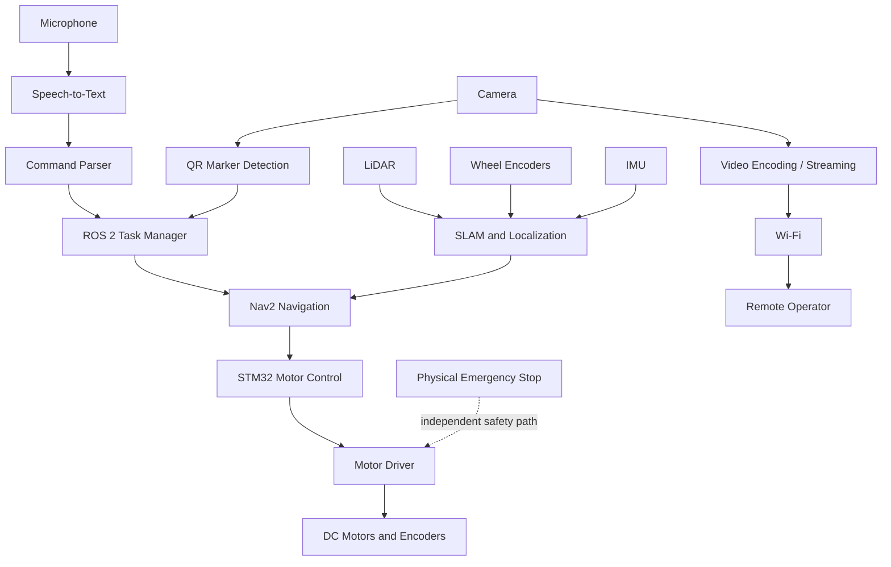

**Autonomous indoor navigation · Voice-based task control · QR-assisted inspection · Live remote vision**

> **Project status: In Progress** — This repository documents an active mobile robotics project. The architecture and performance figures below describe the intended system and engineering targets; they should not be interpreted as completed or validated results.

## Overview

The Voice-Driven Inspection Robot is being developed as an indoor mobile robot that can accept high-level spoken instructions, navigate to named locations, avoid obstacles, inspect designated areas, and provide a camera feed to a remote operator.

The goal is to let an operator specify **what the robot should do**, while the robot handles the lower-level steps involved in executing the task. For example, a command such as **“Go to Lab 2 and start inspection”** is intended to be converted into a navigation task, followed by inspection and a return-to-base task.

The system is designed around a two-level computing architecture:

- **Raspberry Pi 4:** high-level autonomy, ROS 2 integration, voice-command processing, mapping and navigation, QR-code recognition, and camera streaming.
- **STM32 microcontroller:** timing-sensitive motor control, PWM generation, and encoder acquisition.

The project is intended for mapped indoor environments such as laboratories, offices, and campus spaces.

## Project Objectives

- Accept a defined set of spoken commands and convert them into robot tasks.
- Navigate to named indoor locations using a map and localization.
- Use LiDAR-based perception for mapping and obstacle-aware navigation.
- Identify semantic locations using camera-readable QR markers.
- Support inspection and patrol workflows.
- Stream camera video to a remote operator over Wi-Fi.
- Provide a dedicated physical emergency-stop mechanism independent of voice processing.

## System Architecture

The intended data flow is summarized below.

### Main software and hardware responsibilities

| Subsystem | Intended responsibility |
|---|---|
| Voice interface | Capture speech, convert it to text, and identify the requested task and destination. |
| ROS 2 task manager | Coordinate commands and pass navigation or inspection requests to the relevant nodes. |
| SLAM and localization | Build or use an environment map and estimate the robot's pose using available sensor data. |
| Nav2 | Plan and execute navigation toward a goal while responding to obstacles. |
| QR marker recognition | Detect and decode location markers, such as `Lab 2` or `Home`, to associate physical places with semantic names. |
| STM32 firmware | Handle low-level motor actuation and encoder readings with predictable timing. |
| Camera and streaming | Provide visual feedback to the remote operator over Wi-Fi. |
| Emergency stop | Allow the operator to stop the robot using a physical control without relying on speech recognition. |

## Intended Command Modes

The command interface is planned around a small, explicit set of task types to keep behavior predictable.

| Mode | Intended behavior | Example command |
|---|---|---|
| **Navigate** | Travel to a named location. | “Go to Lab 2.” |
| **Inspect** | Reach or hold at an inspection location and provide visual feedback. | “Inspect Lab 2.” |
| **Patrol** | Follow a configured route or loop. | “Start patrol.” |
| **Return** | Navigate back to the designated base location. | “Return to base.” |
| **Stop** | Cancel the active task and stop robot motion through the appropriate control path. | “Stop.” |

Voice commands are intended to trigger high-level tasks rather than directly control individual motors.

## Hardware

The system design includes the following components. Exact board variants and sensor models should be confirmed in the hardware configuration before deployment.

| Component | Role | Status in the design |
|---|---|---|
| Raspberry Pi 4 | Main onboard computer for ROS 2 and high-level processing | Core platform |
| STM32F3/F7-class microcontroller | Low-level motor control and encoder acquisition | Board variant to be confirmed |
| DC motors with wheel encoders | Locomotion and odometry feedback | Required for the mobile base |
| Motor driver / H-bridge | Interfaces the microcontroller with the motors | Required for the mobile base |
| LiDAR | Mapping, localization support, and obstacle perception | Planned sensor input |
| Camera | QR recognition and remote visual monitoring | Planned sensor input |
| Microphone | Voice command input | Planned sensor input |
| IMU (MPU6050 shown in the design) | Inertial measurements for motion estimation | Intended sensor input |
| ToF or ultrasonic sensor | Short-range obstacle detection / safety support | Intended sensor input |
| Physical emergency-stop switch | Immediate operator-requested stop | Safety requirement |

## Software and Tools

The proposed software stack includes:

- **ROS 2** — communication and integration between robot software components.
- **Nav2** — goal-based mobile navigation.
- **SLAM and localization tools** — environment mapping and pose estimation.
- **Gazebo** — simulation and testing of the robot in a virtual environment.
- **Python** — development of high-level nodes and voice/audio processing where appropriate.
- **Embedded C/C++** — microcontroller firmware for motor control and sensor interfacing, depending on the selected firmware setup.
- **Computer vision / QR decoding** — semantic location recognition from camera images.

The ROS 2 distribution, package versions, and exact dependency list will be documented once the software environment is finalized. Installation and launch commands should be added alongside verified package and launch-file names rather than assumed in advance.

## Development Status

This is an active prototype. Progress and integration status may change as the hardware and software components are brought together.

| Workstream | Current status |
|---|---|
| Gazebo environment | Initial simulation world created; robot behavior and navigation validation remain ongoing. |
| Mobile base and encoders | Encoder calibration and physical drive testing have been started. |
| Voice-command pipeline | Audio capture and preprocessing experiments are underway; end-to-end task execution is still being integrated. |
| SLAM and Nav2 | Part of the target architecture; full robot-level performance still needs validation. |
| QR-based semantic locations | Planned for associating physical markers with named destinations; integration and accuracy testing remain. |
| Live video streaming | Part of the target architecture; latency and reliability must be measured on the assembled system. |
| Emergency stop | Included as a design requirement; hardware behavior must be verified before operation. |

**Important:** A feature appearing in the architecture or demo plan does not mean that it is already implemented. The project should be considered experimental until the full workflow has been demonstrated and tested on the target hardware.

## Validation Targets

The project presentation defines the following **proposed targets**, to be measured against ground truth. These are goals, not achieved results.

| Metric | Proposed target |
|---|---:|
| QR detection accuracy | ≥ 80% |
| QR identification accuracy | ≥ 98% |
| QR localization error | ≤ 15 cm |
| Robot localization error | ≤ 20 cm |
| Mapping dimensional error | ≤ 15 cm |
| Navigation success rate | ≥ 90% |
| Obstacle detection accuracy | ≥ 90% |
| Inspection-point arrival error | ≤ 20 cm |
| Live camera latency | ≤ 500 ms |

These values should only be reported as achieved after repeated tests, with test conditions and measurement procedures recorded.

## Planned Demonstration

The intended end-to-end demonstration is:

1. Start the robot at the designated base location.
2. Give a command such as **“Go to Lab 2 and start inspection.”**
3. Convert the command into a task and resolve the semantic destination.
4. Navigate toward the destination using the map and obstacle-aware planning.
5. Use the camera feed for remote visual inspection.
6. Return to base on command.
7. Run a separate patrol test with an obstacle introduced along the route, and observe the robot's response.

The complete sequence is still under development and must be validated before it is described as a successful system demonstration.

## Safety Notes

- Do not rely on voice recognition as the sole emergency-stop mechanism.
- Verify that the physical emergency stop reliably disables or safely stops motor actuation before testing autonomous motion.
- Test at low speeds in a controlled, uncluttered area first.
- Keep a human operator ready to intervene during hardware trials.
- Treat obstacle avoidance as an evolving capability, not a guarantee that collisions cannot occur.
- Do not run unsupervised tests around people or valuable equipment until safety behavior has been validated.

## Getting Started

At this stage, the repository's exact package structure and launch commands are still being finalized. Once the ROS 2 packages, firmware, and configuration files are committed, this section should document:

1. Supported operating system and ROS 2 distribution.
2. Required system packages and Python dependencies.
3. Firmware build and flashing procedure for the selected STM32 board.
4. How to launch the simulation in Gazebo.
5. How to launch the robot on hardware.
6. How to start voice input, navigation, QR detection, and video streaming.
7. How to calibrate the encoders and verify the emergency stop.

Avoid running example commands copied from another robot configuration until they match this project's actual package names, topic names, sensor drivers, and launch files.

## Future Work

- Finalize the ROS 2 workspace and node interfaces.
- Complete and validate the voice-to-task pipeline.
- Integrate SLAM, localization, and Nav2 with the mobile base.
- Integrate QR decoding with the semantic location database and navigation goals.
- Implement and benchmark live video streaming over Wi-Fi.
- Validate motor control, odometry, and encoder calibration.
- Test obstacle handling, task cancellation, and the physical emergency-stop path.
- Measure the validation metrics and document reproducible test procedures.
- Add verified installation, build, and launch instructions.

## Contributing

Development is ongoing. Before proposing changes, keep interfaces and configuration consistent across the ROS 2 nodes, microcontroller firmware, and robot hardware. Document new dependencies and include reproducible steps for testing behavior on simulation or hardware.

## License

A license has not yet been specified. Add a `LICENSE` file before redistributing the project or accepting external contributions.
